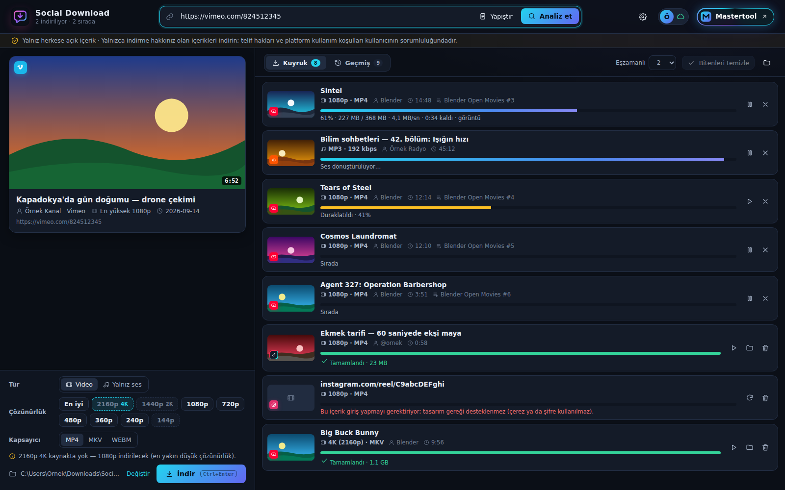

# Social Download

Master Tool › Araçlar: sosyal medya platformlarındaki **herkese açık** bağlantılardan video ve ses indiren Windows masaüstü
uygulaması. Bağlantıyı yapıştırın; başlık, küçük resim, süre, platform ve kaynaktaki çözünürlükler görünür. İndirmeden önce
çözünürlüğü (2160p … 144p), kapsayıcıyı (MP4 / MKV / WebM) ya da **yalnız sesi** (MP3 / M4A / Opus) seçin. Oynatma
listeleri ve kanallar tek tek seçilebilir öğeler olarak listelenir ve seçilen çözünürlükle kuyruğa alınır — kaynakta o
çözünürlük yoksa en yakın düşük çözünürlük indirilir.

- Tanıtım: https://mastertool.download/araclar/social-download · uygulama kodu `sd`
- Mastertool ortak iskeleti: 8 dil, Gece/Gündüz/Sistem teması, Ayarlar (Genel · İndirme · Motor · Hesap · Kısayollar · Hakkında),
  tepsi, ortak oturum (SSO), güncelleme denetimi. Giriş yapmadan kullanılamaz.

> **Yalnızca indirme hakkınız olan içerikleri indirin; telif hakları ve platform kullanım koşulları kullanıcının sorumluluğundadır.**
> Tasarım gereği: yalnız herkese açık içerik; giriş gerektiren / özel / abonelikli içerik ve DRM'li servisler (Netflix,
> Spotify, Disney+ …) desteklenmez; DRM atlatma, çerez ya da tarayıcı çerezi içe aktarma yoktur (bkz. `docs/site-teknik.md`).



## Özellikler

- **Analiz**: tek ya da çok satırlı yapıştırma (en çok 25 bağlantı birden), sürükle-bırak, isteğe bağlı pano algılama;
  izleme parametreleri (`si`, `utm_*`, `fbclid` …) atılır.
- **Biçim seçimi**: kaynakta olan çözünürlükler; seçilen yoksa "720p indirilecek" gibi açık uyarı. Yalnız ses: MP3 / M4A /
  Opus, 128–320 kbps ya da en iyi VBR. Başlık ve bilgiler dosyaya yazılır (meta veri).
- **Oynatma listesi / kanal**: tüm öğeler seçili gelir, tek tek kaldırılabilir; özel / silinmiş / canlı öğeler seçilemez;
  isteğe bağlı liste adında alt klasör, `{index}` ile sıralı dosya adları.
- **Kuyruk**: 1–4 eşzamanlı indirme, ilerleme / hız / kalan süre (görüntü + ses parçaları ve birleştirme aşaması ayrı),
  duraklat / sürdür (kaldığı yerden) / iptal (yarım dosyalar silinir) / yeniden dene, sıra değiştirme, anlaşılır hata
  nedenleri; bitince oynat / klasörde göster. Uygulama kapanıp açılınca kuyruk geri gelir. Nazik istek aralığı (varsayılan
  2 sn) ve isteğe bağlı hız sınırı.
- **Geçmiş**: son 200 indirme; yeniden indir, kaynağı aç. İsteğe bağlı şifreli senkron.
- **Platformlar**: yt-dlp'nin desteklediği herkese açık siteler — YouTube, Instagram (herkese açık gönderi/reels), TikTok,
  X/Twitter, Facebook (herkese açık video), Vimeo, Dailymotion, Twitch (klip/VOD), Reddit, SoundCloud, Bilibili, Bandcamp …
- **Motor**: yt-dlp (Unlicense) + FFmpeg LGPL (paylaşılan kitaplıklar) uygulamayla gelir. Uygulama içinden **"Motoru
  güncelle"**: yalnız yt-dlp'nin resmi GitHub sürümlerinden; SHA2-256SUMS'un OpenPGP imzası gömülü yt-dlp anahtarıyla
  (parmak izi `AC0C BBE6 848D 6A87 3464 AF4E 57CF 6593 3B5A 7581`), ikili SHA-256 ile doğrulanır, çalıştırılıp sürümü
  denetlenmeden kullanılmaz.
- **Kısayollar**: Ctrl+V yapıştır ve analiz et · Enter analiz · Ctrl+Enter indir · Del kuyruktan kaldır · Boşluk duraklat/sürdür ·
  F5 yeniden dene · Ctrl+A tümünü seç · Ctrl+O klasörü aç · Ctrl+L bağlantı çubuğu · Ctrl+1/2 sekmeler · Ctrl+, ayarlar · Esc.

## Geliştirme

```bash
npm install
npm run engine:linux        # Linux'ta deneme için motor (vendor/engine/linux64; git'e girmez)
npm start                   # Electron
npm test                    # birim + ana süreç (ağ ve gerçek motor yok, yt-dlp çıktısı sahte JSON)
npm run screenshots         # docs/screenshots (tr) ve docs/screenshots/en — Chromium: CHROMIUM_PATH
npm run e2e                 # gerçek Electron: giriş, analiz, kuyruk (Linux'ta DISPLAY gerekir)
npm run icon                # build/icon.svg → icon.png + icon.ico
npm run engine              # Windows motoru: vendor/engine/win64 (yt-dlp.exe + FFmpeg LGPL DLL'leri + lisanslar)
npm run engine:pin          # manifesti son yt-dlp / FFmpeg sürümlerine sabitle (imza + sha256 doğrulamalı)
npm run dist                # Windows: kurulum + portable (dist/)
```

| Dosya | Görevi |
| --- | --- |
| `src/main.js` | Ana süreç: depo, pencereler, tepsi, analiz, kuyruk, geçmiş, motor, IPC |
| `src/urls.js` | Bağlantı ayıklama, platform tanıma, oynatma listesi ipucu; DRM / yerel / şifreli adres reddi |
| `src/formats.js` | Kullanılabilir çözünürlükler, en yakın düşük çözünürlük, yt-dlp biçim argümanları |
| `src/queue.js` | Kuyruk durum makinesi ve zamanlayıcı (eşzamanlılık, nazik aralık, geri yükleme) |
| `src/ytdlp.js` | yt-dlp argümanları (yasaklı seçenek denetimi), analiz/indirme süreçleri, ilerleme ve hata sınıflandırma |
| `src/engine.js` + `src/openpgp.js` | Motor konumu ve imza + SHA-256 doğrulamalı yt-dlp güncellemesi |
| `src/account.js`, `src/sso.js` | Mastertool hesabı, uçtan uca şifreli senkron (`/api/sd`, `sdl-enc-v1`), ortak oturum |
| `scripts/fetch-engine.js` + `engine-manifest.json` | Derlemede motoru resmi sürümlerden indirir ve doğrular |

Sunucu adresi `SD_API` ortam değişkeniyle değiştirilebilir (varsayılan `https://mastertool.download`). Geliştirmede motor
yolları `SD_YTDLP` ve `SD_FFMPEG_DIR`, motor klasörünün tamamı `SD_ENGINE_DIR` ile verilebilir.

## Yayın

`v1.2.3` etiketi gönderilince GitHub Actions motoru indirip doğrular, Windows exe'lerini derler, Release'e ekler ve
mastertool.download'a parçalı yükler (secret `SOCIALDOWNLOAD_RELEASE_KEY`, kısa adı `SD_RELEASE_KEY` da kabul edilir;
sunucu `.env`'inde `SOCIALDOWNLOAD_RELEASE_KEY`). Sürüm yayını yalnız açık onayla yapılır.

## Lisans

MIT. yt-dlp Unlicense; FFmpeg LGPL-2.1-or-later (paylaşılan kitaplıklar, kaynak bağlantısı `licenses/ffmpeg-SOURCE.txt`);
lisans metinleri kurulumda `resources/engine/licenses/` altındadır (Ayarlar › Hakkında › Motor lisansları).
